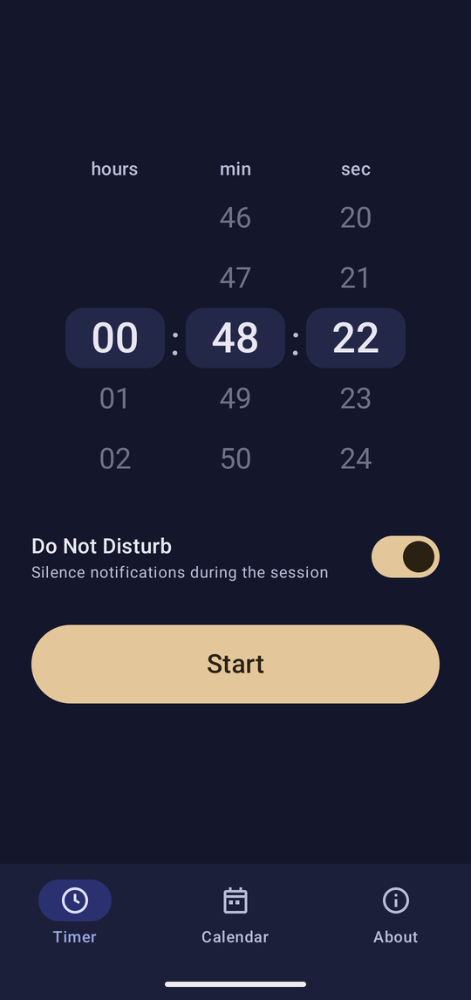
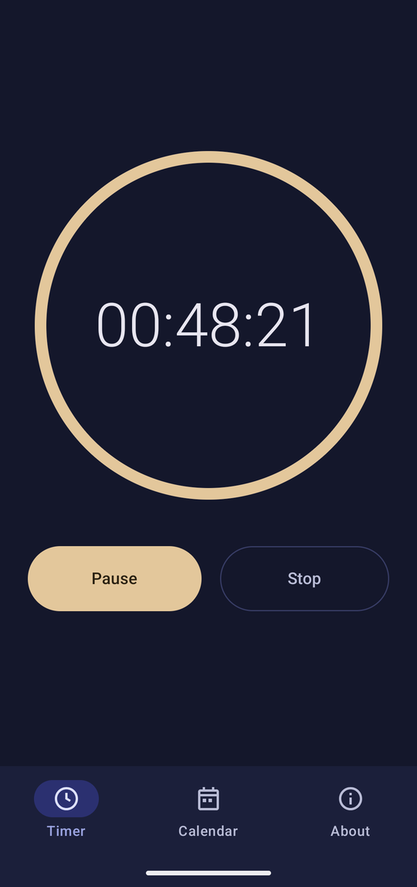
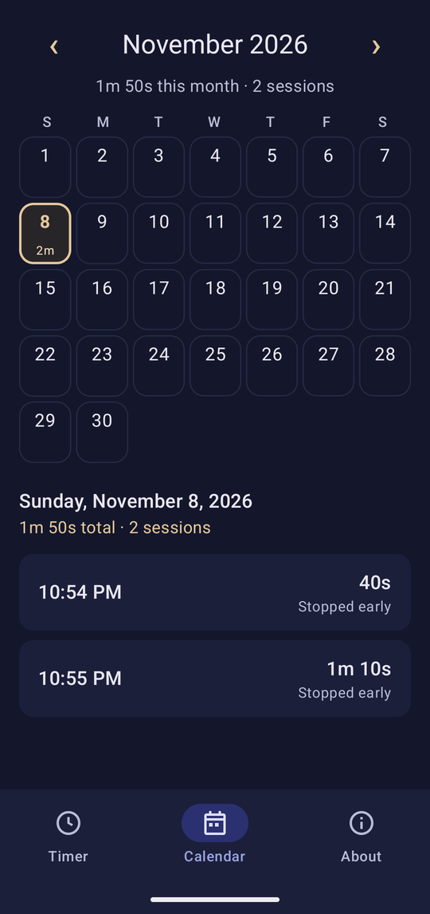
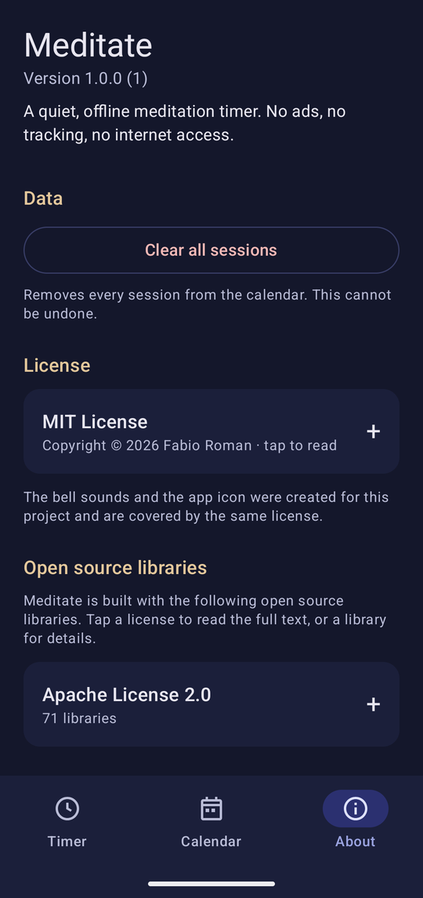

# Meditate

A minimal, offline meditation timer for Android, built with Kotlin and Jetpack Compose.

**Minimum Android version: 12 (API 31).** Android only; there is no iOS version.

<p align="center">
  
  
  
  
</p>

## Features

- Timer with three wheels (HH : mm : ss). The duration you last started with is remembered (20 minutes on first launch).
- 5 second countdown, then a soft singing-bowl bell. Three strikes when the session ends.
- Pause, resume or stop at any time. A notification with the same controls keeps working with the screen off.
- Optional Do Not Disturb ("Priority only") for the length of the session; the previous state is restored afterwards.
- Calendar with the days you meditated and the time spent. Tap a day to see every session; several sessions per day are summed.
- About page with the app's licence and the licences of all dependencies, and a button to clear all recorded sessions.
- No network access (the app does not even request the `INTERNET` permission), no analytics, no ads. Everything stays on the device.

## Install

This app is not on the Play Store. Download `app-release.apk` from the [Releases](../../releases) page, copy it to your phone and open it (Android will ask you to allow installs from that source). Or, with USB debugging enabled:

```bash
adb install -r app-release.apk
```

On first start, allow notifications (so the session notification is visible). The first time you start a session with Do Not Disturb enabled, the app sends you to the system screen where you grant "Do Not Disturb access"; you can also switch the option off and never grant it.

## How the details work

- **Recorded time** is the time actually meditated, excluding pauses and the countdown. Sessions stopped early are saved too (marked "Stopped early"); sessions under 10 seconds are discarded. A session that crosses midnight counts for the day it started.
- **Do Not Disturb:** if DND is already on when a session starts it is left untouched, and it is only switched off again if it is still in the state the app set. A crash cannot leave it stuck: the app also restores it on the next start.
- **Sounds** are played on the *alarm* audio stream so they are heard under DND. Use the volume keys while the app is open to adjust them.
- Stopping a session manually is silent; the end bell only rings when the timer reaches zero.
- A session is lost if Android kills the app process or the phone reboots mid-session.

## Build

Prerequisites: Android SDK (platform 37 and build-tools) and a **JDK 17 or newer** (the JBR bundled with Android Studio works).

```bash
# once: tell Gradle where the SDK is
echo "sdk.dir=/path/to/Android/Sdk" > local.properties

./gradlew testDebugUnitTest      # unit tests
./gradlew assembleDebug          # debug APK -> app/build/outputs/apk/debug/
./gradlew lintRelease assembleRelease
```

On Windows use `gradlew.bat`, and set `JAVA_HOME` to a JDK 17+ if your default `java` is older.

### Signed release APK

Create a keystore once (keep it somewhere safe and **back it up**: without it you cannot update an installed app in place):

```bash
keytool -genkeypair -v -keystore ~/.android/meditate-release.jks -alias meditate \
  -keyalg RSA -keysize 4096 -validity 36500
```

Then create `keystore.properties` in the repository root (it is git-ignored, never commit it):

```properties
storeFile=/home/you/.android/meditate-release.jks
storePassword=...
keyAlias=meditate
keyPassword=...
```

`./gradlew assembleRelease` then produces a signed, minified `app/build/outputs/apk/release/app-release.apk`. Without `keystore.properties` the release APK is simply left unsigned.

## Sounds and icon

All assets are original work created for this project; nothing is taken from third parties.

- **Bells:** `tools/audio/generate_sounds.py` synthesises a singing-bowl style bell (inharmonic partials, slow beating, soft attack, light reverb). The output is deterministic (fixed random seed). Regenerate with:

  ```bash
  pip install numpy soundfile
  python tools/audio/generate_sounds.py
  ```

  Tweak the constants at the top of the script (pitch, decay, reverb) and re-run to change the character. Output goes to `app/src/main/res/raw/`.
- **Icon and tab icons:** hand-written vector drawables in `app/src/main/res/drawable/`.
- **Screenshots** in `docs/screenshots/` were taken on a real device.

## Project layout

```
app/src/main/java/io/github/romanfabio/meditate/
  session/   state machine (SessionEngine), SessionManager, foreground SessionService
  audio/     BellPlayer
  dnd/       DndController
  data/      Room database, repository, preferences
  ui/        timer, calendar, about, theme
tools/audio/ sound generator (development tool, not part of the app)
```

`SessionEngine` has no Android dependencies and is unit-tested with a fake clock. See [CLAUDE.md](CLAUDE.md) for development notes.

## Licenses

Meditate is released under the [MIT License](LICENSE), covering the source code and the generated assets (bell sounds, icon, screenshots).

**Libraries shipped in the app** (all Apache License 2.0): AndroidX (core, activity, lifecycle, Room, SQLite and others), Jetpack Compose and Material 3, Kotlin standard library, kotlinx.coroutines. They have no `NOTICE` obligations; the full list with versions and the licence text is shown on the About page of the app.

The build enforces this policy: the [AboutLibraries](https://github.com/mikepenz/AboutLibraries) Gradle plugin (build time only, nothing from it ships in the app) reads the licence metadata of every dependency, **fails the build** on anything that is not Apache-2.0, MIT, BSD-2/3-Clause or ISC, and generates the data shown on the About page.

**Development tools, not distributed with the app:** the Android Gradle Plugin, Kotlin compiler, KSP and Room compiler (Apache-2.0), JUnit 4 and kotlinx-coroutines-test for tests (EPL-1.0 / Apache-2.0), and Python with NumPy and SoundFile (BSD-3-Clause) for the sound generator (SoundFile wraps libsndfile, LGPL-2.1, used only as a tool and not redistributed here).
